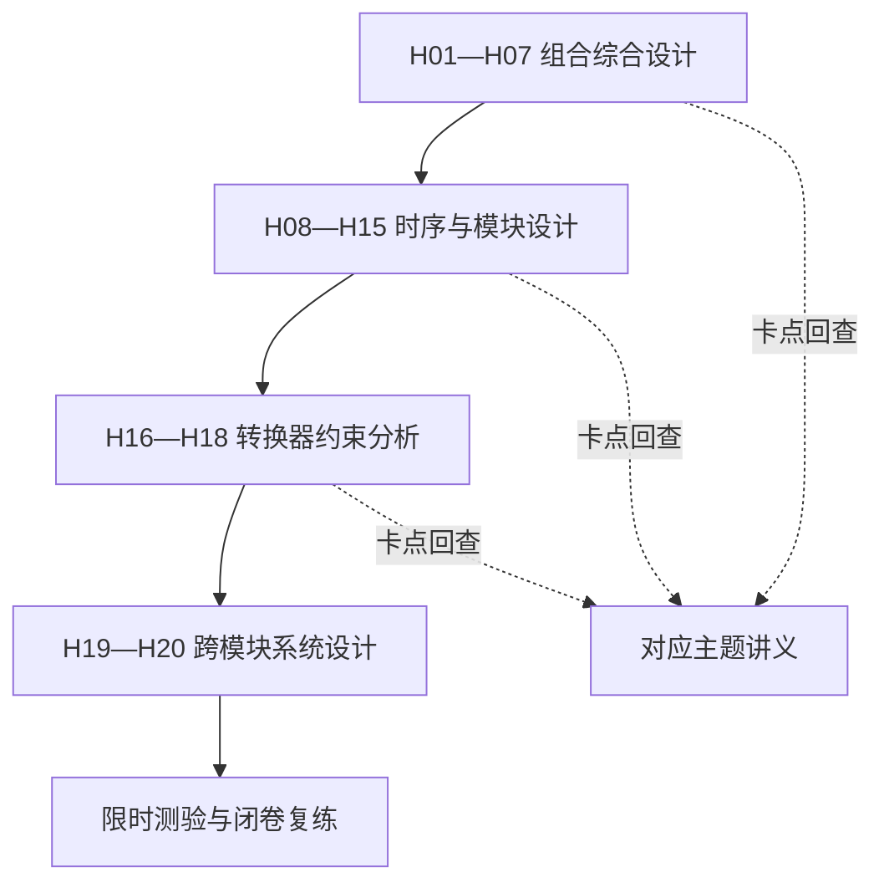

# 学习路线与考纲映射

以用户 2026-10-14 提供的五部分考纲为边界，按用户最新要求组织高阶、难题驱动路线。不是对某校官方最新考纲的重新认定；当前没有把原资料中各校分值比例当成用户考试权重。

## 逐条对应

| 考纲要求 | 讲义 | 核心学习产出 |
|---|---|---|
| 逻辑代数基本定律、运算规律 | 02、03 | 会写、会用定律并验证等价 |
| 逻辑函数各种表达方式 | 02、04、06 | 真值表、逻辑式、逻辑图、卡诺图、波形互换 |
| 代数与卡诺图化简 | 03、04 | 最简与或／或与、约束与无关项 |
| 组合逻辑定义、分析、设计 | 06、07 | 从电路到功能及从需求到电路 |
| 竞争冒险与消除 | 08 | 静态 1／0、路径延迟、冗余覆盖、适用条件 |
| 数字集成电路输入输出特性 | 05 | 电平、噪声容限、驱动、扇出、三态与 OC |
| 编码器、译码器与 MSI 应用 | 09 | 优先级、有效标志、低有效译码、多输出与扩展 |
| 数据选择器、数据分配器 | 10 | 数据端函数、使能、极性与扩展 |
| 全加器、加法器、数值比较器 | 11 | 进位、BCD 校正、加减控制与比较 |
| 触发器结构、动作特点、逻辑分类 | 12、13 | 锁存／边沿／主从区别、有效沿及异步控制 |
| 触发器状态描述、转换、简单应用 | 12、13、18、20 | 特性表、激励表、转换、计数与寄存 |
| 时序定义与描述、分析步骤和工具 | 14 | 状态表、状态图、时序图、驱动与次态方程 |
| 状态化简方法 | 15 | 等价划分、编码与未用状态 |
| 同步时序设计 | 16 | 原始图、化简、编码、激励、连接、验证 |
| 异步时序设计 | 17 | 异步计数、基本模式流表、稳定性、临界竞争 |
| 计数器及 MSI 模块 | 18、19 | 任意模、使能、装载、清零、级联、分频 |
| 寄存器及 MSI 模块 | 20 | 并行装载、保持、移位、串并转换 |
| 移位寄存器型计数器 | 21 | 环形、扭环形、反馈、序列与自启动 |
| D/A 基本原理与典型电路 | 22 | 权电阻、R—2R、传输式与建立时间 |
| A/D 基本原理与典型电路 | 23 | 采样保持、量化、Flash、SAR、双积分 |
| D/A、A/D 主要指标 | 24 | 位数、LSB、精度、误差、单调性与速度 |

## 学习方式

先做高阶题，再按卡点查讲义。数制、门符号与基本定义不设独立入门课；基础题不进入必做清单。全部考纲项仍需覆盖，题目难度通过多约束设计、实现比较和异常情况验证提升。

主线为 H01—H07 组合设计、H08—H15 时序设计、H16—H18 转换器综合、H19—H20 跨模块系统。原资料中的独立 555 波形发生、存储器扩容、ROM／PLA 专题不在本次主线内；提高训练不等于无边界扩展考试范围。

## 统一作答约定

正逻辑；变量编号按题中排列从高到低；状态位 Q3Q2Q1Q0 从高到低；时序题若有实际器件以其功能表为准。低有效端明确写出，非号覆盖范围使用公式标明。量化、满量程及输出采样时刻均以题目具体定义优先。
