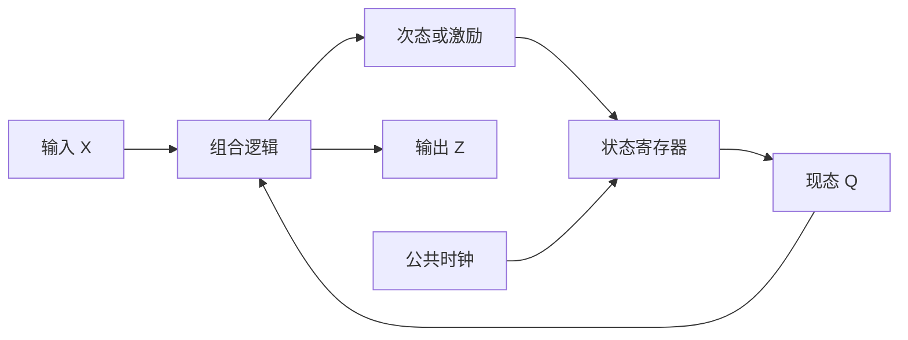

# 14 时序电路描述与分析

> 高阶题卡点参考：按《42天学习计划》需要查阅，不要求从基础章节顺读。配套题：[[例题14-时序电路描述与分析]]。

## 用状态压缩历史

时序电路由组合逻辑与存储单元组成。状态不是输入历史的逐字记录，而是为预测后续输出必须保留的信息。现态向量 Q、输入 X、次态 $Q^+$ 与输出 Z 满足：

$$Q^+=f(Q,X).$$

Moore 型输出 $Z=g(Q)$；Mealy 型输出 $Z=g(Q,X)$。前者输出只依赖状态，后者还可能随当前输入改变。类型不是由触发器型号决定的。

## 同步电路分析六步

1. 识别存储单元类型、公共时钟及复位，定义状态位顺序。
2. 从实际接线写每个触发器的驱动函数。
3. 代入各自特性方程，得到完整次态方程；另写输出方程。
4. 枚举现态与输入，列次态和输出；全部未用状态也应检查。
5. 将表转成状态图，再按给定初态、输入序列画时序。
6. 用语言说明功能、正常状态环、异常状态去向和是否自启动。

## 表、图、波形各负责什么

状态表适合系统检查；状态图便于看到环路和可达性；时序图体现具体输入序列下的过程。Mealy 图弧常标 X/Z；Moore 图在节点标状态/输出。写时序输出时应说明是在沿前读取还是沿后读取。

## 一次更新的纪律

同步电路所有位用同一拍的旧状态求新状态。不要把计算次序当成物理更新顺序。异步电路各触发器时钟不同，不能直接套这个规则，需逐事件分析。

## 自启动与复位不是同义词

自启动通常要求从任意编码状态出发，在规定输入条件下都能进入正常工作循环，不存在异常封闭环或死锁。复位则是外部强制进入指定初态。一个只有复位后能正常工作的电路未必自启动。

计数器分析不要只从 000 开始走一圈；还需枚举剩余状态。带外部输入的控制器应说明恢复是否依赖某种输入序列。

## 对照阅读

《考点精讲》PDF 113—122 页；《真题解析》PDF 37—41 页。页码均为 PDF 阅读器从封面起计的页码；原资料存在符号错误，见 [[资料索引与勘误]]。

返回 [[数电大师必修-学习导航]]。
