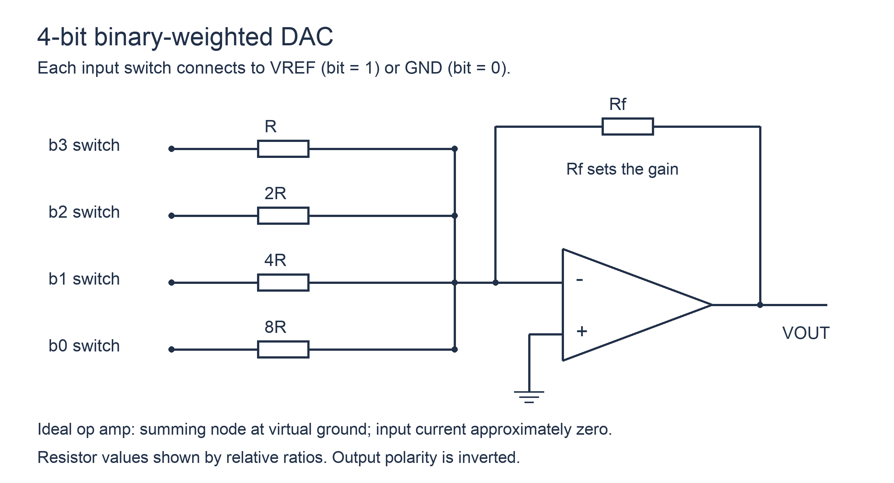

# 22 D／A转换器原理

> 学习对象：学过但遗忘；按《42天学习计划》分配学习。配套题：[[例题22-D／A转换器原理]]。

## 从代码到按权求和

DAC 接收数字码，输出与其数值对应的模拟电压或电流。对无符号 n 位码 $D=\sum b_i2^i$，常见理想单极性电压模型为 $V_o=V_{ref}D/2^n$；若是反相求和结构则带负号及可能的增益系数。

不要仅凭“n 位 DAC”就确定输出式。先确认参考电压符号、反馈电阻比例、是否反相，以及代码类型。

## 权电阻网络

各支路使用按二进制比例变化的电阻。位为 1 时接参考电压，位为 0 时接地；理想运放反相端为虚地，输入电流近似为 0。于是支路电流按位权相加，再由反馈电阻转成输出：

$$V_o=-R_f\sum_i\frac{b_iV_{ref}}{R_i}.$$

这个通式比直接套 $-V_{ref}D/2^n$ 更稳妥，后者只有在相应阻值比例下成立。高位电阻较小、权重较大；位数增加使电阻跨度与匹配要求变高。

## R—2R 梯形网络

图中 b3 为最高位。各开关的 1 端接求和总线，0 端接地；示意开关均画在 1 位置，不代表输入必须全为 1。最右侧 2R 是终端电阻。理想条件下，支路电流从 b3 到 b0 依次为 $V_{ref}/(2R)$、$V_{ref}/(4R)$、$V_{ref}/(8R)$、$V_{ref}/(16R)$；取 $R_f=R$ 时得到 $V_o=-V_{ref}D/16$。这里给出的是此图的通用传输规律，不代入配套题数值。

只用 R 和 2R 两种阻值，通过重复分流形成二进制权重，便于电阻匹配。分析时先从终端逐节求等效电阻，再确认各支路电流的二分关系；开关接法、电压模式与电流模式的电路不同，不能只看“R—2R”三个字就确定极性或增益。

本项目题目若不附完整梯形图，会明确给出理想传输关系；权电阻题则逐支路给出阻值与连接，保证条件完整。

## 最大代码不等于参考电压

对 $V_o=V_{ref}D/2^n$，最小码步为 $q=V_{ref}/2^n$，最大代码是 $2^n-1$，最大输出为 $V_{ref}(1-2^{-n})$。若题目定义“满量程”为最大代码输出值，则相对步长用该值作分母；若定义为整个参考跨度，则用 $V_{ref}$ 作分母。两种约定见讲义 24。

## 动态性能

数字输入更新后，输出需经过建立时间才能进入规定误差带。多位同时翻转可能产生毛刺，不能把理想传输曲线当作实际瞬态波形。分辨率只表示码步细，不保证真实输出准确。

## 解题顺序

先将代码换成整数 D，再写完整传输式及单位，最后代数值。需要反求参考电压或位数时，检查使用的是跨度、最大代码输出还是某个中间码输出。

## 对照阅读

《考点精讲》PDF 186—193 页；《真题解析》PDF 44—47 页中转换器相关题。页码均为 PDF 阅读器从封面起计的页码；原资料存在符号错误，见 [[资料索引与勘误]]。

返回 [[数电大师必修-学习导航]]。
