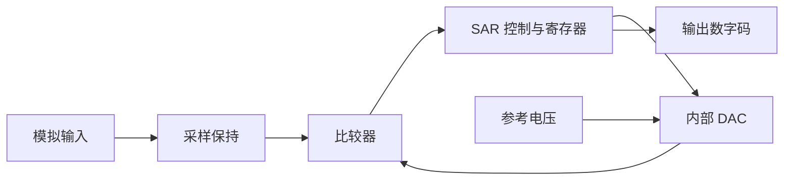

# 23 A／D转换器原理

> 高阶题卡点参考：按《42天学习计划》需要查阅，不要求从基础章节顺读。配套题：[[例题23-A／D转换器原理]]。

## 采样、保持、量化、编码

采样把连续时间变为离散时刻；保持使被转换的电压在转换期间稳定；量化把连续幅值归入有限等级；编码把等级写成二进制码。保持后的电压仍是模拟量，不能把阶梯状波形直接称为数字码。

对理想带限信号，为避免采样频谱重叠，应选采样率高于最高频率的两倍，并在实际系统预留滤波过渡带。采样频率、内部比较时钟、单次转换时间是不同量。

## 量化约定先写清

本项目多数计算采用 $0\le V_{in}<V_R$、$q=V_R/2^n$、向下取整的理想量化器：

$$D=\left\lfloor\frac{V_{in}}q\right\rfloor.$$

代码限制在 $0$ 至 $2^n-1$，超过范围按题目定义饱和。按重建值 $Dq$ 定义误差时，在非饱和区间，向下取整误差满足 $-q<e\le0$；若采用就近舍入，内部非饱和区间通常是 $\pm q/2$。题目不同约定不可混用。

## SAR 的信号关系

比较器给出高低判决，SAR 改写试探码，DAC 把试探码变回电压供下一次比较。输出数字码来自寄存器，不直接来自比较器的单个 0／1。

## 三类典型结构

| 结构 | 转换过程 | 特征 |
|---|---|---|
| 并行比较 Flash | 多比较器同时与一组阈值比较，再编码 | 经典 n 位结构需 $2^n-1$ 个比较器，速度快、硬件多 |
| 逐次逼近 SAR | 从最高位开始试探，DAC 产生试探电压，比较后保留或清除该位 | 约 n 次位判决；实际总时间还含采样和控制开销 |
| 双积分 | 固定时间积分输入，再用反向参考积分回零，测第二阶段时间 | 速度较低，对特定周期干扰有抑制能力 |

SAR 每次试探只决定当前位，高位已决结果保留，低位尚未确定；不是每次从零重新试。比较相等时如何判定需由题目指定。

双积分在两阶段使用同一理想积分常数时，有幅值关系：

$$T_2=\frac{|V_{in}|}{|V_{ref}|}T_1,\qquad N=f_{clk}T_2.$$

输入在第一阶段变化时对应的是该积分窗口的平均效应；抑制 50／60 Hz 干扰需积分时间与干扰周期匹配，并非无条件抗所有干扰。

结构对照：[ADI ADC 架构说明](https://www.analog.com/en/resources/technical-articles/adc-architectures.html)；[ADI ADC 教学章节](https://wiki.analog.com/university/courses/electronics/text/chapter-20)。

## 做题先画信息流

标出模拟输入、参考、比较器、DAC／积分器、控制与输出码的方向。性能比较必须限定同等应用条件，不能仅用“越多位越好”选结构。

## 对照阅读

《考点精讲》PDF 194—201 页；《真题解析》PDF 44—47 页中转换器相关题。页码均为 PDF 阅读器从封面起计的页码；原资料存在符号错误，见 [[资料索引与勘误]]。

返回 [[数电大师必修-学习导航]]。
