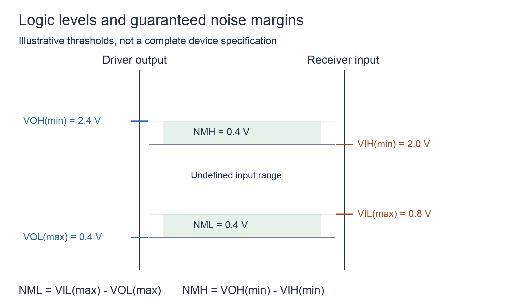

# 数字集成电路输入输出特性

## 知识点介绍

逻辑功能规定输入与输出的 0、1 关系；电气特性规定这些状态在什么电压、电流和时间条件下可靠。连接两个器件必须同时满足电平兼容、负载能力和动态条件。

## 原理讲解与图示

### 电平与噪声容限

$V_{IH(min)}$ 是接收端保证识别为高的最低电压，$V_{IL(max)}$ 是保证识别为低的最高电压；两者之间不保证识别。驱动端在规定负载下保证 $V_{OH(min)}$ 与 $V_{OL(max)}$。

高态输出被噪声向下拉，最多可降低 $V_{OH(min)}-V_{IH(min)}$；低态被向上抬，最多可升高 $V_{IL(max)}-V_{OL(max)}$。因此：

$$NM_H=V_{OH(min)}-V_{IH(min)},\qquad NM_L=V_{IL(max)}-V_{OL(max)}.$$

任一容限为负，都表示直流电平不能保证兼容。图中的数值只用于说明定义，不是所有 TTL／CMOS 的通用参数。

### 扇出由高、低态共同限制

若每个相同负载的最大输入电流为 $|I_{IH}|$、$|I_{IL}|$，N 个负载的总电流分别为其 N 倍。由驱动器允许电流得：

$$N\le\left\lfloor\min\left(\frac{|I_{OH}|}{|I_{IH}|},\frac{|I_{OL}|}{|I_{IL}|}\right)\right\rfloor.$$

这是静态估计。输入电容与布线电容相加，即使直流电流很小，总电容也会使边沿变慢。$t_{PLH}$ 与 $t_{PHL}$ 分别是输出低到高、高到低的传播延迟，不是输入建立时间。

### 输出结构与并接条件

| 结构 | 高态 | 低态 | 连接性质 |
|---|---|---|---|
| 推挽 | 主动拉高 | 主动拉低 | 普通输出不能直接相连 |
| OC／OD | 晶体管截止，由外部上拉形成高态 | 晶体管导通灌电流 | 可在规定条件下接公共上拉节点 |
| 三态 | 可输出高或进入高阻 | 可输出低或进入高阻 | 共用总线时仅允许一个驱动器有效 |

OC／OD 共接节点只要有一个器件拉低就为低，全部释放才为高，因此在正逻辑下构成线与。高阻 Z 表示不主动驱动，不能当作逻辑 0。

### 上拉电阻为什么有上下限

低态要保证灌电流不超限，若负载另向节点提供总低态电流 $I_L$：

$$\frac{V_{CC}-V_{OL}}R+I_L\le I_{OL(max)}.$$

高态总漏电流 $I_{leak}$ 会在电阻上产生压降：

$$V_H=V_{CC}-I_{leak}R\ge V_{IH(min)}.$$

前式限制 R 不能太小，后式限制 R 不能太大。上升过程还受 RC 时间常数限制。电平、负载和延迟需使用同一电源及工作条件下的参数。

## 配套例题

### 例题 03-01｜三态总线

两个非反相三态缓冲器共接总线 Y，高有效使能分别为 E1、E2，输入分别为 D1、D2。列出 E1E2 的四种组合下总线工作情况；对 D1≠D2 的情形指出不允许的使能组合。

### 例题 03-02｜上拉电阻

5 V 电源通过上拉电阻 R 接 OC 输出节点；低态输出电压按 0.4 V 计算，最大允许灌电流 4 mA；高态总漏电流按 50 μA 计算，要求节点至少为 3.5 V。求 R 同时满足两种直流约束的范围。忽略电容。

### 例题 03-03｜接口负载与逻辑延迟联合约束

5 V 上拉电源经 R 连接一个 OC 输出节点，该节点驱动 N 个相同逻辑输入。低态输出电压按 0.4 V 计算，OC 最大灌电流 8 mA；每个负载低态有 0.2 mA 流出其输入并流入驱动器，高态漏电流按 10 μA 流入接收器。高态要求节点不低于 3.5 V。每个输入电容 5 pF，布线总电容 20 pF。

释放低态后，高态节点近似按 $v(t)=V_\infty-(V_\infty-0.4)e^{-t/(RC)}$ 上升，其中 $V_\infty=5-N\times10\,\mu A\times R$，$C=20\,pF+N\times5\,pF$。要求在 100 ns 内达到 3.5 V。R 可连续选择，忽略其他漏电及电容。

1. 求给定 N 时 R 的两项直流约束和上升时间约束。
2. 判断 N=8 时是否存在可行 R；若存在给出一个值并逐项验证。
3. 求可满足全部约束的最大整数 N，允许数值计算，给出搜索边界和验证依据。
4. 解释只用静态扇出公式为何不能完成本题。

---

资料对应：《真题解析》9—15 页；TI 逻辑产品设计手册。PDF 页码从封面计；来源见 [[资料来源与勘误]]。
