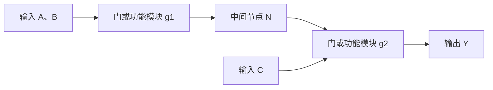

# 组合逻辑电路分析与设计

## 知识点介绍

组合电路的稳态输出只由当前输入决定，不保存历史状态。分析是从连接得到功能；设计是把功能要求实现为连接。二者共有的核心是完整的输入输出映射。

## 原理讲解与图示

### 电路连接对应函数复合

该结构表示 $N=g_1(A,B)$、$Y=g_2(N,C)$，所以 $Y=g_2(g_1(A,B),C)$。中间节点消去后得到整体函数，但物理延迟仍属于原电路，不能用化简后的门数代替原路径。

多输出电路对应函数向量 $\mathbf Y=\mathbf F(\mathbf X)$。两个输出可共用节点，其逻辑功能分别确定，共用节点的负载却会增加。

### 条件、优先级与非法输入

“至少 k 个输入为 1”和“恰好 k 个为 1”是不同的输入集合。设计中的每个输出本质上是在判断输入是否属于某个集合。非法输入若可能发生，也需要纳入定义。

优先级可表示为互斥条件。若条件 $C_1$ 优先于 $C_2$，后者真正获准的区域为 $\overline{C_1}C_2$。只把 $C_1,C_2$ 分别送往不同输出，不能保证二者互斥。

逻辑定义需区分“事件成立”和“引脚有效电平”：事件变量为 1，不代表实际器件一定输出高；低有效输出还要取反。

### 不同器件对应不同分解方式

| 实现结构 | 函数分解 |
|---|---|
| 两级与或 | 若干乘积项的并集 |
| 译码器加门 | 按输入完整组合产生最小项，再合成输出 |
| 数据选择器 | 按部分变量分支，每个分支实现剩余子函数 |
| 加法器／比较器 | 利用已定义的算术或大小关系 |

选择器适合子函数简单的分解，译码器便于多个输出共享最小项。门数最少、器件数最少和关键路径最短可能对应不同结构。

### 稳态正确不等于暂态正确

忽略延迟时，输入变化后输出由函数立即确定；实际电路中各路径先后到达。真值表能证明稳态映射一致，不能证明没有毛刺。反馈若引入多个可保持稳定状态，则电路已具有记忆，不能继续当作普通组合逻辑。

## 配套例题

### 例题 04-01｜结构与波形

$Y=\overline{\overline{AB}\cdot\overline{AC}}$ 由两个第一级与非门和一个第二级与非门实现。各门传播延迟均为 5 ns，A 原为 0，B=C=1；t=0 时 A 从 0 变为 1。写出各中间节点及 Y 的变化时刻，并画波形。

### 例题 04-02｜编码转换

将一位余 3 码输入 ABCD 转换为 8421 BCD 输出 WXYZ。仅合法余 3 码可能出现。列转换表并分别化简四个输出；要求明确注明无关输入。

### 例题 04-03｜BCD控制与故障优先

输入 X3X2X1X0 表示一位 8421 BCD，另有使能 E 和紧急信号 S，均高有效。输出 L、M、H、F 都高有效，要求：

- S=1 时只有 F=1，其他输出全为 0，不受 E 和数码影响。
- S=0、E=0 时所有输出为 0。
- S=0、E=1 时，数值 0—2 只令 L=1，3—6 只令 M=1，7—9 只令 H=1；非法码 10—15 只令 F=1。

1. 建立完整分情况表并求四输出函数。
2. 设计一种共用中间项的门电路实现，标明优先控制如何落实。
3. 证明任意输入下最多一路输出为 1。
4. 若要求 S 上升后所有普通输出“绝无任何短暂残留”，仅凭静态逻辑式能否保证？说明还需规定哪些时序条件。

---

资料对应：《考点精讲》55—72 页。PDF 页码从封面计；来源见 [[资料来源与勘误]]。
