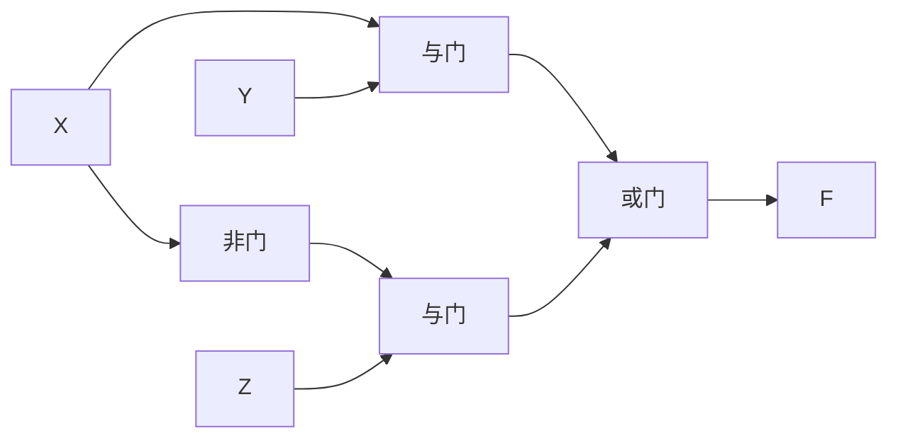

# 竞争冒险与消除

## 知识点介绍

同一输入沿不同路径到达输出的时间不同，会发生竞争；若竞争导致输出出现不应有的短暂变化，就形成冒险。冒险是实现结构与延迟的问题，不能只看稳态函数。

## 原理讲解与图示

### 静态与动态冒险

| 类型 | 理想变化 | 暂态错误 |
|---|---|---|
| 静态 1 | 始终为 1 | 短暂为 0 |
| 静态 0 | 始终为 0 | 短暂为 1 |
| 动态 | 只翻转一次 | 反复翻转后才稳定 |

对两级与或式 $F=XY+\overline XZ$，当 Y=Z=1 时，F 的稳态值与 X 无关；但 X 变化时，两个乘积项的交接可能存在同时为 0 的时间窗。

反相路径比直达路径多经过一个门，但到底哪一方向产生毛刺，还取决于各门的上升、下降延迟，不能仅说“多一级就一定出错”。

### 冗余项为何能维持输出

加入 YZ 后，X 变化期间存在一条不依赖 X 的有效路径：

$$XY+\overline XZ+YZ=XY+\overline XZ.$$

等式保证稳态功能不变，YZ 的物理路径则补足了交接空隙。两级与或的卡诺图判据是：在**单输入变化**条件下，每一对相邻确定 1 由同一个乘积项共同覆盖。两级或与的静态 0 判据对应相邻 0 的共同和项覆盖。

### 判据的适用范围

单变量变化只在卡诺图相邻格间移动；多变量变化可经过多个中间组合，原函数在中间组合可能本来就要求相反输出。即使消除了所有相邻静态冒险，也不能据此保证任意多输入变化无毛刺。

多级实现还可能出现动态冒险。化简或把多输入门拆成二输入网络后，拓扑改变，需要重新分析。

### 采样与滤波不是逻辑等价变换

延后采样可避开暂态，但必须给出输出最迟稳定时间及后级建立时间。增加输出寄存器会改变输出时刻，不能忽略新增周期。滤波依赖脉宽和阈值；异步清零或时钟端对短脉冲敏感，毛刺可能直接改变存储状态。

## 配套例题

### 例题 05-01｜静态 0

$F=(A+B)(\overline A+C)$ 用两级或与电路实现。分析静态 0 冒险条件，并给出消除该类冒险的等价实现。

### 例题 05-02｜毛刺时间

$F=AB+\overline AC$，B=C=1。A 原为 1，在 t=0 变为 0。A 到反相器输出延迟 8 ns，两只与门延迟各 4 ns，或门延迟 3 ns；均按纯传输延迟处理。画各节点波形，判断毛刺类型及持续时间。

### 例题 05-03｜无冒险实现与延迟验证

函数 $F(A,B,C,D)=\Sigma m(2,3,6,7,8,9,12,13,14,15)$，无无关项，编号按 ABCD。

1. 求最简两级与或实现，并标明各乘积项覆盖范围。
2. 在一次仅一个输入变化的条件下，找出该实现全部可能发生静态 1 冒险的相邻输入对。
3. 构造静态 1 无冒险的两级与或实现，要求先使乘积项总数最少，再比较文字数。
4. 在第 1 问实现中选一组危险转换。假定原变量直达路径无附加延迟，反变量须经 6 ns 反相器，各与门延迟 4 ns，末级或门延迟 3 ns，采用纯传输延迟。分别考察该转换两个方向，画节点和输出波形。
5. 若允许两个输入同时改变，说明第 3 问能否保证无毛刺，并给出论证或反例。

---

资料对应：《考点精讲》101—105 页。PDF 页码从封面计；来源见 [[资料来源与勘误]]。
