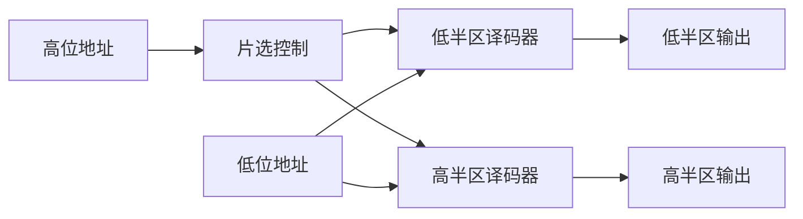

# 编码器与译码器

## 知识点介绍

编码器把有效输入的编号写成代码；译码器把代码转成某一路有效。普通编码器要求输入互斥，优先编码器允许多个请求并同时给出优先级最高者。

## 原理讲解与图示

### 优先编码与有效标志

四输入高有效优先编码器，优先级 $I_3>I_2>I_1>I_0$，编号输出为 $Y_1Y_0$：

$$Y_1=I_3+I_2,\qquad Y_0=I_3+\overline I_2I_1.$$

最高编号是 3 时两位为 1；否则只有在 2 不请求、1 请求时，最低位才为 1。无请求与仅 I0 请求都可能得到代码 00，所以还需要：

$$V=I_3+I_2+I_1+I_0.$$

有效标志不是额外编码位，而是说明代码是否代表真实请求。级联时先比较组有效性及组优先级，再选择组内代码。

### 译码器与最小项

高有效 n—$2^n$ 译码器在使能时输出 $Y_i=m_i$；低有效版本输出 $L_i=\overline{m_i}$。因此对 $F=\sum_{i\in S}m_i$：

$$F=\overline{\prod_{i\in S}L_i}.$$

这解释了低有效译码器后接与非门产生最小项之和，而不是把低有效输出直接相或。

### 74LS138 的地址与使能

器件地址 CBA 从高到低，编号 $i=4C+2B+A$。G1=1 且两个低有效使能 G2A=G2B=0 时，选中输出为 0，其余为 1；禁止时全部输出为 1。函数变量名与芯片引脚名可能相同，但连接时其高低位含义必须对应。[TI 器件说明](https://www.ti.com/product/SN74LS138)。

扩展时，高位地址选择器件，低位地址选择该片内部输出；合法地址应恰好选通一片。多片推挽输出不能直接并接为同一输出。

### 显示译码与分配

七段显示译码把数字编码映射为 a—g 七个段状态，共阳与共阴的点亮电平不同。译码器的使能端也可接数据，用作分配器；选中输出是否与数据同相，由所用使能端和输出极性共同决定。

## 配套例题

### 例题 06-01｜多输出

用一片低有效 3—8 译码器及必要门电路同时实现 $F_1=\Sigma m(0,2,5,7)$、$F_2=\Sigma m(1,3,4,6)$，函数变量顺序 ABC。译码器已使能。画电路并判断两个输出之间的关系。

### 例题 06-02｜译码器扩展

用两片 74LS138 和最多一只反相器实现 4—16 低有效译码器，输入 X3X2X1X0，X3 为最高位，无总使能要求。给出两片地址端、三个使能端和 16 路输出的编号对应。

### 例题 06-03｜优先编码与模块级联

有 8 路高有效请求 R7—R0，优先级从 R7 到 R0 递减。要求输出有效标志 V 和最高有效请求的三位编号 Y2Y1Y0；无请求时规定 V=0、Y=000。可使用两只理想四输入优先编码器和门电路。每只编码器对本组 I3—I0 按高编号优先，输出 v、y1y0；本组无请求时 v=0、y1y0=00。

1. 给出级联逻辑及全部输出表达式，保证同时多请求时正确。
2. 再生成八路高有效授权 G7—G0，任意时刻最多一路为 1，禁止直接假设只会有一个请求。
3. 用一片低有效 3—8 译码器加门电路实现授权，并规定无请求时的使能条件。
4. 当高优先请求撤销而低优先请求保持时，指出静态正确的系统为何仍需检查暂态多路授权，并提出系统接口必须满足的要求。

---

资料对应：《考点精讲》73—81 页。PDF 页码从封面计；来源见 [[资料来源与勘误]]。
