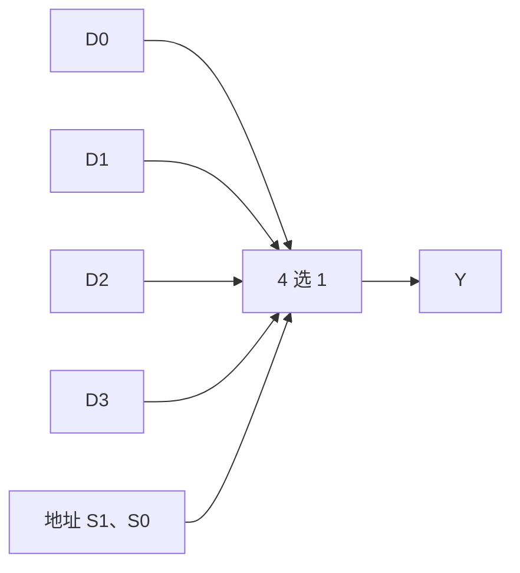

# 数据选择器与数据分配器

## 知识点介绍

数据选择器按地址从多路数据中选一路输出；数据分配器按地址把一路数据送到指定出口。选择器实现逻辑函数的本质是将函数按地址变量展开。

## 原理讲解与图示

### 香农展开与选择器

对任一布尔变量 X，函数在 X=0、X=1 时的子函数分别为 $F_0,F_1$，于是：

$$F=\overline XF_0+XF_1.$$

因为 X 与反 X 互斥，每组输入只保留一个子函数。对两个地址继续展开：

$$F=\overline S_1\overline S_0D_0+\overline S_1S_0D_1+S_1\overline S_0D_2+S_1S_0D_3.$$

如果所有变量都接地址，数据端只需常量 0／1；若还剩一个变量 Z，数据端可能是 0、1、Z、反 Z；剩多个变量时，数据端是这些变量的逻辑子函数。改变地址变量会改变外接逻辑的复杂度。

### 74LS151 的同相与反相输出

74LS151 为 8 选 1，地址 CBA 从高到低，选通端低有效。使能时同相输出 Y 跟随选中的数据，W 与其相反；禁止时 Y=0、W=1。题给符号若采用不同命名，应按其功能表理解。[TI 器件说明](https://www.ti.com/product/SN74LS151)。

### 分配器的函数

高有效 1 分 4 分配器，数据为 D：

$$Y_0=D\overline S_1\overline S_0,\quad Y_1=D\overline S_1S_0,$$
$$Y_2=DS_1\overline S_0,\quad Y_3=DS_1S_0.$$

地址选择的不是输入数据，而是数据去往的输出。D=0 时所有输出为 0；D=1 时它表现为高有效译码器。

### 扩展与延迟

多级 MUX 可按地址层次构成更大选择器：低位地址选择组内数据，高位地址选择组。输出经过的模块延迟需要累计。使能可关闭整片，但禁止态输出未必为高阻，不能因此直接把多个输出连在一起。

## 配套例题

### 例题 07-01｜8 选 1 实现

用一片 74LS151 实现 $F(A,B,C,D)=\Sigma m(0,2,5,7,8,10,12,13)$，规定器件地址高到低分别接 A、B、C，可提供 D 和反 D。列全部数据端接法、使能接法及所用输出端。

### 例题 07-02｜分配与扩展

设计高有效 1 分 8 数据分配器，地址 A2A1A0、数据 X；仅选中输出等于 X，其余输出为 0。只允许使用两只高有效 1 分 4 分配器（各有一个高有效使能端）及必要反相器，画接线并写各输出表达式。

### 例题 07-03｜选择器变量分配优化

$F(A,B,C,D)=\Sigma m(0,1,3,4,6,8,9,11,12,14)$，编号按 ABCD。只能使用一只同相 4 选 1 MUX 与少量二输入与、或、非门，器件始终使能，外部只提供原变量。

1. 从 A、B、C、D 中任取两个作为 S1、S0，对六种无序选择分别求四个数据端函数；每组内按原变量字母顺序作高、低地址。
2. 对每种选择化简数据端函数，给出外接门数与最大逻辑级数，允许共用中间信号。
3. 选择你认为最合适的连接并说明使用的优化标准，再从最终接线重建完整真值表。
4. 改用低有效 3—8 译码器加门电路实现同一函数，允许选择三变量接地址；比较两种结构的器件和路径代价。

---

资料对应：《考点精讲》82—92 页。PDF 页码从封面计；来源见 [[资料来源与勘误]]。
