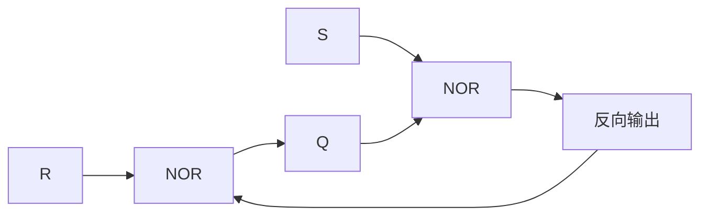
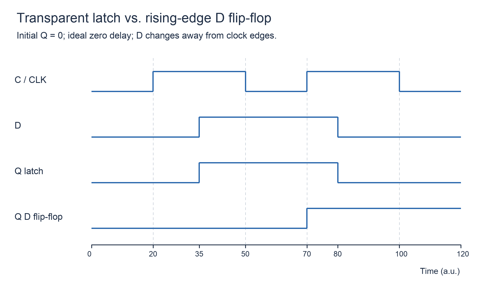

# 锁存器与触发器

## 知识点介绍

锁存器和触发器均能保持一位状态。结构决定何时接收信息，逻辑功能决定接收后变成什么状态；SR、D、JK、T 分类与上升沿／下降沿分类是两个不同维度。

## 原理讲解与图示

### 交叉反馈怎样形成存储

NOR 型 SR 锁存器的反馈关系为：

$$Q=\overline{R+\overline Q},\qquad \overline Q=\overline{S+Q}.$$

这里的 $\overline Q$ 指正常状态下互补的另一个物理输出；禁止输入时，两端未必互补。

S=1、R=0 强制反向输出为 0，使 Q=1；S=0、R=1 则 Q=0；S=R=0 时反馈维持先前状态。S=R=1 时两端均为 0，失去正常互补关系，释放后的结果依赖延迟。NAND 型采用低有效输入，保持与禁止输入组合随之改变。

### 电平敏感与边沿敏感

D 锁存器在使能有效期间透明，输出可随 D 变化；使能关闭后保持。边沿 D 触发器在有效沿采样，两个有效沿之间不随 D 连续变化。

图中控制为高的窗口内，锁存器响应 D 的变化；上升沿触发器仅在控制信号上升时更新。图采用理想零延迟模型，数据变化避开采样沿。

主从结构由两个交替开放的锁存环节组成，输出更新时刻与内部采样窗口有关；不能在未确认结构时把所有主从器件都当作理想单边沿采样。

### 特性方程

令 Q 为现态、$Q^+$ 为有效动作后的次态：

| 类型 | 次态关系 | 输入含义 |
|---|---|---|
| 高有效 SR | $Q^+=S+\overline RQ$，SR=0 | 置位、清零、保持 |
| D | $Q^+=D$ | 复制采样值 |
| JK | $Q^+=J\overline Q+\overline KQ$ | 00 保持、01 清零、10 置位、11 翻转 |
| T | $Q^+=T\oplus Q$ | 0 保持、1 翻转 |
| T′ | $Q^+=\overline Q$ | 每次有效动作翻转 |

### 特性表与激励表的方向不同

特性关系由输入和现态求次态，激励关系由期望转移反求允许输入：

| Q→Q⁺ | D | T | J K | S R |
|---|---|---|---|---|
| 0→0 | 0 | 0 | 0 X | 0 X |
| 0→1 | 1 | 1 | 1 X | 1 0 |
| 1→0 | 0 | 1 | X 1 | 0 1 |
| 1→1 | 1 | 0 | X 0 | X 0 |

表中 X 是实现自由度，不是实际引脚的未知电平。高有效 SR 仍须满足不同时为 1。异步置位、清零优先于正常时钟数据关系，具体优先级由器件规定。

## 配套例题

### 例题 09-01｜激励选择

某状态位连续状态要求为 0→1→1→0→0→1。分别用 D、T、JK 和高有效 SR 触发器实现，逐步列出允许激励，不要求化简为输入函数。

### 例题 09-02｜锁存与边沿

高有效 D 锁存器与上升沿 D 触发器共用输入 D 和控制信号 C，初态均为 0。C 在 10—30 ns、50—70 ns 为 1，其余为 0；D 在 0—15 ns 为 0、15—25 ns 为 1、25—45 ns 为 0、45 ns 后为 1。忽略延迟并假定无时序违例，分别画 Q 波形。

### 例题 09-03｜异步清零波形

上升沿 D 触发器初态 Q=1，上升沿在 10、30、50、70 ns；沿前 D 依次为 0、1、1、0。低有效异步清零 CLR 在 35—43 ns 为 0，其余为 1，且释放满足时序要求。忽略传播延迟，画 0—80 ns 的 Q 波形。

---

资料对应：《考点精讲》106—112 页。PDF 页码从封面计；来源见 [[资料来源与勘误]]。
