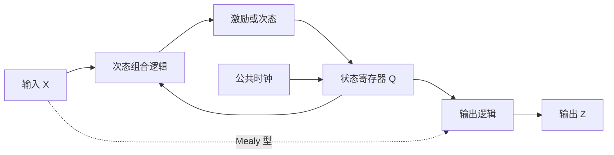
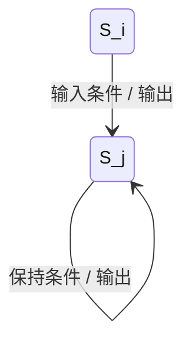

# 时序电路的状态描述与分析

## 知识点介绍

时序电路用状态保存影响未来行为的历史信息。描述一个状态机，需要次态关系、输出关系和动作时刻；状态表、状态图和时序图分别展示完整映射、连接关系与具体时间过程。

## 原理讲解与图示

### 状态与组合逻辑的关系

$$\mathbf Q^+=\mathbf f(\mathbf Q,\mathbf X).$$

Moore 型输出为 $\mathbf Z=\mathbf g(\mathbf Q)$；Mealy 型为 $\mathbf Z=\mathbf g(\mathbf Q,\mathbf X)$。Mealy 输出可能在时钟间隔内随 X 改变；Moore 输出虽只取决于状态，实际多位译码仍可能产生暂态毛刺。

### 驱动方程不等于次态方程

从电路读取的 J、K、D、T 函数叫驱动／激励方程。D 型恰有 $Q^+=D$；JK 型必须再代入 $Q^+=J\overline Q+\overline KQ$，不能把 J 直接当次态。

对 n 位状态、m 位输入，完全指定同步电路的状态表包含 $2^{n+m}$ 行逻辑组合。若输出在沿前观察，它对应本行现态；沿后 Moore 输出则需用更新后的状态计算。

### 状态图的标注

上图为 Mealy 弧标注示意，输出写在转换弧上；Moore 图通常把输出写在状态节点内。节点代表抽象状态，不一定等于十进制计数值。

### 周期、可达性与自启动

从给定初态反复按输入条件迭代次态函数，得到该次运行的轨迹。无外部输入计数器最终进入循环；循环中的不同状态数是状态周期。某输出可能在更短时间重复，因此输出最小周期不一定等于状态周期。

只从复位态走完正常环，说明该初态可正常工作；要判断自启动，还需考察所有异常编码是否进入正常环。外部复位把电路强制送回初态，不等于电路本身能自行脱离异常闭环。带使能时，“最终恢复”还可能依赖后续出现有效计数事件。

## 配套例题

### 例题 11-01｜JK 电路分析

两只公共上升沿 JK 触发器，$J_0=K_0=1$，$J_1=K_1=Q_0$，Z=Q1Q0。写驱动、次态、输出方程，列状态表并确定计数模数；初态 00。

### 例题 11-02｜Mealy 时序

两状态机 S0、S1，初态 S0。S0 在 X=0 时转 S0、Z=0，在 X=1 时转 S1、Z=0；S1 在 X=0 时转 S0、Z=1，在 X=1 时转 S1、Z=0。输入依次 1、1、0、1、0、0；每拍 Z 按沿前状态和当前 X 计算。列逐拍状态与输出，判断所检测的模式。

### 例题 11-03｜异常状态

某无外部输入同步电路完整次态为 000→001→010→011→100→000；另外 101→110、110→101、111→000。画完整状态图，判断是否自启动，并提出满足“所有状态最终进入正常五状态环”的修改要求。

---

资料对应：《考点精讲》113—122 页。PDF 页码从封面计；来源见 [[资料来源与勘误]]。
