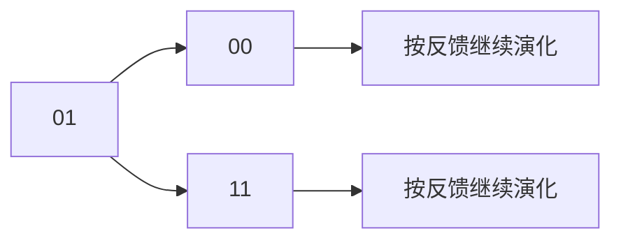

# 异步时序电路

## 知识点介绍

异步计数器通过不同触发器的局部时钟逐级动作；基本模式异步控制器则通过反馈连续变化，直到进入稳定状态。两者都不能按公共时钟下一次同时更新处理。

## 原理讲解与图示

### 异步计数按局部有效沿传播

第一级翻转后，只有它的输出形成第二级规定的有效沿，第二级才翻转；依次传播。后级若改接反 Q 或改变上升／下降沿类型，计数方向可能改变。中间暂态编码真实存在，不能用最终稳定数值代替其时序过程。

### 基本模式与稳定项

采用单输入变化基本模式：一次只改变一个外部输入，且下一次变化前内部已经稳定。设现态反馈为 y，组合网络激励为 $Y=f(x,y)$。固定输入时，$Y=y$ 是稳定点；$Y\ne y$ 表示状态仍要改变。

流表的每列对应一个固定外部输入。外部输入变化后，在新列沿目标状态继续追踪，直到稳定；若进入没有稳定点的循环，可能持续振荡。

### 状态竞争与临界竞争

若目标转移要求两位从 01 变为 10，实际可能先经过 00，也可能先经过 11。若不同先后顺序导致不同最终稳定状态，就是临界竞争；若最终稳定态一致，则是非临界竞争。

通过相邻赋码或引入中间状态可控制允许的变化路径。只让状态位单比特变化并不能消除组合网络毛刺；组合冒险与状态竞争属于不同问题。

### 从目标反馈到 SR 驱动

对高有效 SR 锁存器，可选择：

$$S=\overline yY,\qquad R=y\overline Y.$$

现态为 0 且目标为 1 才置位；现态为 1 且目标为 0 才清零；相同则保持。稳态布尔关系下 SR=0，但实际门延迟仍需检查，不应把布尔互斥当作任意瞬间互斥。

### 逻辑与物理前提

流表、状态分配和反馈函数描述逻辑行为；输入变化模式、反馈延迟与冒险控制共同决定物理实现是否符合该行为。同步电路的“等下一个时钟沿再读取”不能直接用于无公共时钟的反馈环。

## 配套例题

### 例题 14-01｜异步模计数设计

使用下降沿 T 触发器和必要门电路设计异步模 6 加法计数器。触发器有低有效异步清零端，T 端固定为 1。画出时钟、反馈清零接线；列有效状态及截断时的过渡状态，说明需要检查的清零时序条件。

### 例题 14-02｜竞争路径

某异步反馈电路在固定输入条件下的激励映射为 00→11、01→01、10→11、11→11。初态为 00，两个状态位延迟不一致。分别追踪低位先变和高位先变的路径，判断是否存在临界竞争；提出状态分配或过渡控制应满足的改进原则。

### 例题 14-03｜异步流表与无临界竞争赋码

基本模式异步控制器只有一个外部输入 X，每次改变后等待内部稳定才允许再次改变。初态 A、X=0，输出 Z 为状态输出，流表如下。

| 现态 | X=0 目标状态 | X=1 目标状态 | Z |
|---|---|---|---|
| A | A | B | 0 |
| B | C | B | 1 |
| C | C | D | 1 |
| D | A | D | 0 |

1. 标出所有稳定项，并列 X 连续交替变化时的稳定状态序列。
2. 先采用 A=00、B=01、C=10、D=11，检查每条允许状态转换中的竞争路径，判断是否存在临界竞争。
3. 重新赋予两位状态编码，要求每次允许转移只改变一个状态位；求反馈激励函数和 Z。
4. 用高有效 SR 锁存器及门电路实现，求置位复位驱动并检查禁止输入组合。
5. 分开论证状态赋码、组合静态冒险和基本模式输入约束各自解决的问题，说明只满足单比特赋码是否足以保证任意物理实现正确。

---

资料对应：《考点精讲》113—122、134—143 页；Stanford 异步时序章节。PDF 页码从封面计；来源见 [[资料来源与勘误]]。
