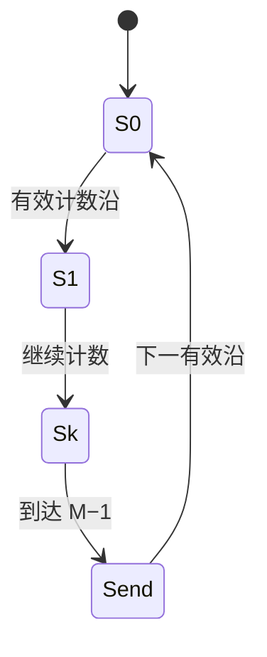

# 计数器与分频

## 知识点介绍

计数器把有效时钟事件映射为有限状态序列。模数 M 是正常计数循环中的状态数；n 位触发器有 $2^n$ 种编码，只有被纳入正常循环的编码才计入模数。

## 原理讲解与图示

### 同步二进制计数的翻转条件

所有触发器共享时钟。以 $Q_0$ 为最低位，用 T 触发器实现加计数：

$$T_0=E,\qquad T_i=E\prod_{j=0}^{i-1}Q_j,\qquad Q_i^+=Q_i\oplus T_i.$$

低位全部为 1 时，加 1 才向本位产生进位。减计数则要求低位全部为 0：$T_i=E\prod_{j=0}^{i-1}\overline Q_j$。这里的乘积来自**同一个沿到来前的现态**，不包含本次已经更新的低位。

### 模 M 与边界状态

从 0 到 M−1 构成 M 个正常状态。同步反馈清零在现态为 M−1 时提出清零请求，使下一个沿回到 0；若到 M 才提出同步清零，M 就会占据一个完整周期。

异步反馈清零则可在进入 M 后立即清零，因此 M 是短暂出现的译码状态。其脉冲宽度、译码毛刺与复位恢复时间会影响可靠性，不能仅凭状态数认为两种结构等价。

图中的 Sk 表示中间状态段，省略的状态仍各占一个计数周期。

### 任意序列与自启动

非二进制序列的状态表先规定正常循环，再为未用编码分配去向。若未用编码形成闭环，系统从该闭环启动后无法进入正常计数；若都能有限步到达正常循环，才满足自启动要求。

无关项可以简化驱动逻辑，但必须把化简后的电路代回所有未用状态检查。题目要求自恢复时，不能直接把这些状态全部当作无关项。

### 模数、频率和占空比

若输出在每 M 个输入周期中产生一个完整重复图样，其频率为 $f_{CP}/M$。若终端脉冲每 M 周期令另一触发器翻转一次，该触发器输出的完整周期却是 2M 个输入周期。

计数状态循环为 M，输出不一定也以 M 为最小周期。单个状态译码通常产生窄脉冲；若高电平持续 k 个完整时钟周期，占空比为 k/M。只在同一类时钟沿改变输出时，奇数 M 无法用整数 k 得到严格 50% 占空比。

## 配套例题

### 例题 15-01｜可逆计数

设计 3 位同步可逆二进制计数器，控制 M=1 加计数、M=0 减计数，采用 T 触发器，所有输入在上升沿前稳定。求各 T 输入逻辑并验证 000 和 111 两个边界状态。

### 例题 15-02｜分频波形

一个理想同步模 10 计数器按 0000 至 1001 自然序循环，初态 0000，输入时钟 20 kHz。画完整循环的 Q3 与“状态等于 9”高有效译码输出 P；计算各自周期、重复频率和高电平占空比，忽略延迟。

### 例题 15-03｜可保持且自恢复的模13计数

设计同步模 13 自然二进制计数器，正常环为 0—12。输入 E 为高有效计数使能，R 为高有效同步复位；公共上升沿，R 优先于 E。R=0、E=0 时所有编码均保持；R=0、E=1 时正常计数，编码 13—15 下一拍进入 0。输出 P 只在“当前为 12、E=1、R=0”时为 1。

1. 列完整编码状态表及输出条件，分别用 D 和 T 触发器求驱动函数。
2. 画 D 实现电路，证明全部编码在规定输入条件下可恢复，说明 E 永远为 0 时能否保证恢复。
3. 判断把未用状态直接设为无关项是否必然满足规格，并给出你的实现的验证过程。
4. 初态 11，R 全为 0，E 依次为 1、0、0、1、1、1，列逐拍状态与沿前 P。

---

资料对应：《考点精讲》134—143 页。PDF 页码从封面计；来源见 [[资料来源与勘误]]。
