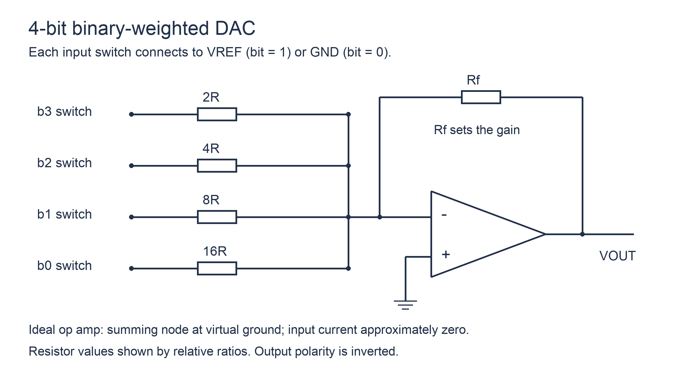
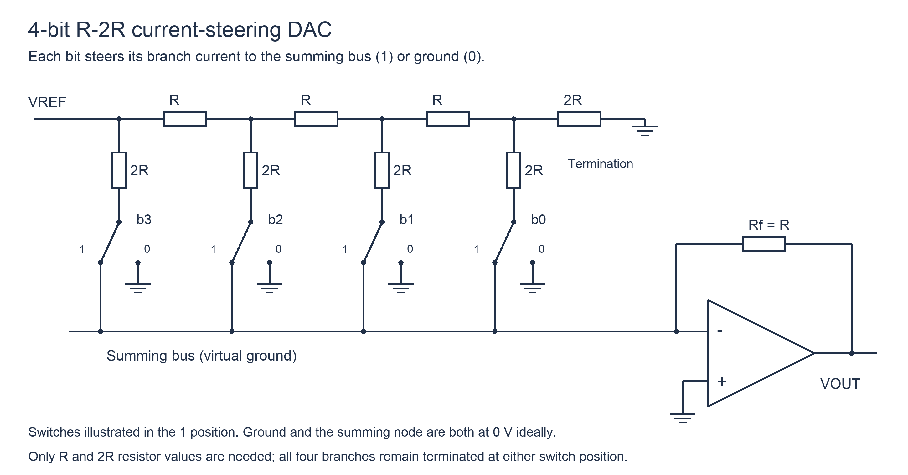

# D／A转换器

## 知识点介绍

DAC 把数字码映射为模拟电压或电流。电路通过各位的二进制权重叠加实现转换；输入编码、参考方向和运放接法共同决定输出的幅值与符号。

## 原理讲解与图示

### 权电阻网络的电流叠加

以下图示采用反相求和结构，开关把各支路接参考电压或地，运放反相端近似虚地。

令 n 位码为 $b_{n-1}\cdots b_0$，$D=\sum_{k=0}^{n-1}b_k2^k$。若第 k 位电阻取 $R_k=2^{n-k}R$，则：

$$I_k=\frac{b_kV_{REF}}{2^{n-k}R},\qquad V_o=-R_f\sum I_k=-\frac{R_f}{R}V_{REF}\frac{D}{2^n}.$$

负号来自反相求和，位权来自电阻比例。只有 $R_f=R$ 时系数才直接为 $-V_{REF}/2^n$。图示电阻与反馈电阻采用何种归一化，应先检查，再代公式。

### R–2R 梯形网络

梯形网络通过重复的 R、2R 结构形成逐级二分电流。电流转向结构把支路电流送到求和节点或地，两端均近似 0 V，因而理想情况下改变代码不会改变梯形网络各位电流。

图中最高位、次高位的电流依次为 $V_{REF}/(2R)$、$V_{REF}/(4R)$，一般第 k 位为 $V_{REF}2^k/(2^nR)$；送入求和节点的电流相加后，仍得到上式。端接的 2R 是保持二分关系的一部分，不能省略。

### 参考跨度与最大代码输出

令理想幅值跨度 $V_S=|R_fV_{REF}/R|$：

$$q=\frac{V_S}{2^n},\qquad |V_{o,max}|=(2^n-1)q=V_S(1-2^{-n}).$$

q 是相邻代码的理想输出增量。最大代码是 $2^n-1$，不是 $2^n$，所以其输出一般小于参考定义的端点跨度。若题目直接把最大代码输出称为“满量程”，则 $q=V_{FS}/(2^n-1)$。

### 编码、输出范围和建立时间

单极性直二进制通常从零开始递增；偏移二进制、补码 DAC 的零点和正负端点不同，不能仅凭二进制码值套用单极性公式。

代码跨越多个翻转位时，各开关不完全同时动作，可形成短暂毛刺。建立时间是输出进入并保持在规定误差带内所需的时间；它与最终静态误差、最小代码步长属于不同指标。

## 配套例题

### 例题 19-01｜权电阻电路

4 位反相权电阻 DAC 的 b3、b2、b1、b0 分别经 R、2R、4R、8R 接理想运放反相求和点；各位为 1 时支路另一端接 +4 V，为 0 时接地；同相端接地，反馈电阻 Rf=R/2。推导输出式，并求代码 1011 时的输出。

### 例题 19-02｜反求参考

一理想 6 位 DAC 满足 $V_o=-V_{ref}D/64$，当代码为 111111 时输出 +3.15 V。求 Vref、1 LSB 输出步长及代码 101010 时输出。

### 例题 19-03｜循环控制与模拟输出综合设计

设计一个八步波形发生系统：公共上升沿时钟，E 为高有效推进使能，R 为高有效同步复位且优先于 E。地址循环 0—7，每地址对应的 4 位无符号码依次为 0、2、5、9、15、9、5、2。每拍推进时，输出数据寄存器应装入“本拍更新后地址”对应的码；E=0 时地址与数据均保持，R=1 时地址和数据都为 0。

DAC 为理想 4 位反相转换器，$V_o=-V_{ref}D/16$，Vref=−8 V。可用 D 触发器、门电路和理想同相 8 选 1 MUX；不得用 ROM。输出模拟值按数据寄存器稳定后的代码确定。

1. 设计地址状态机，给出驱动函数及复位、使能优先级。
2. 设计四位数据逻辑与输出寄存器，明确 MUX 地址接现态还是次态以及由此带来的功能区别。
3. 初始复位完成，E 连续为 1，列 8 拍沿后的地址、数据码和模拟输出；再验证在任意状态暂停后恢复不会重复或跳过位置。
4. 输出寄存器时钟到输出最大延迟 5 ns，DAC 建立时间 30 ns；在每次时钟沿后 50 ns 采样模拟输出是否满足这两项限制？同时指出未给出的哪些条件还会限制最高时钟频率。
5. 从最终接线反推方程，核对规格；不把数据与地址错一拍视为仅“相位不同”。

---

资料对应：《考点精讲》186—193 页。PDF 页码从封面计；来源见 [[资料来源与勘误]]。
