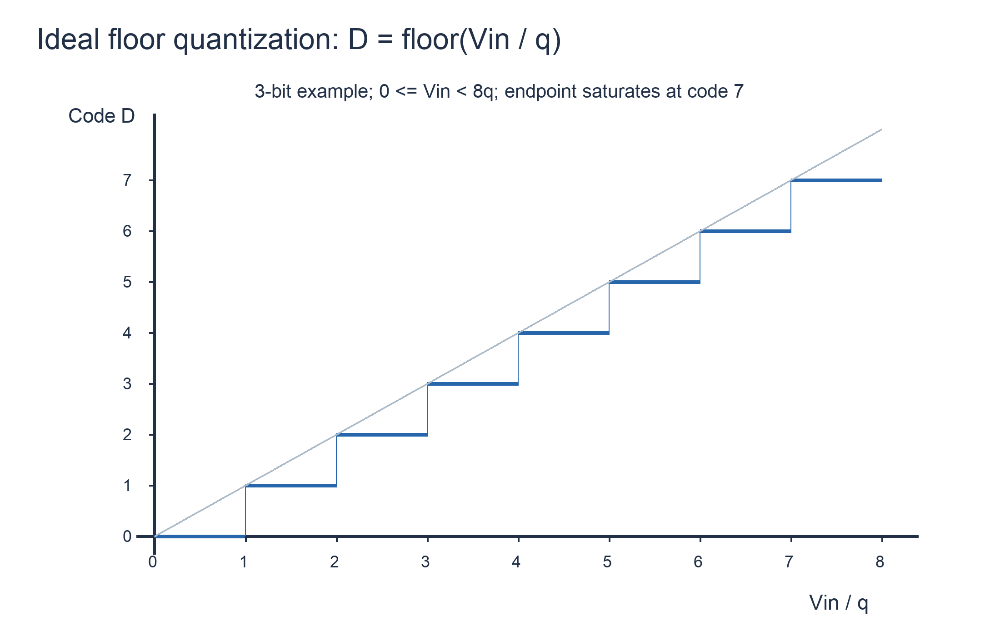
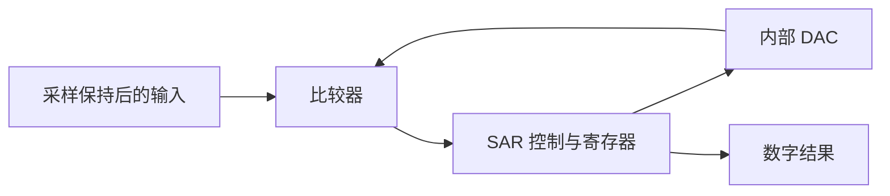
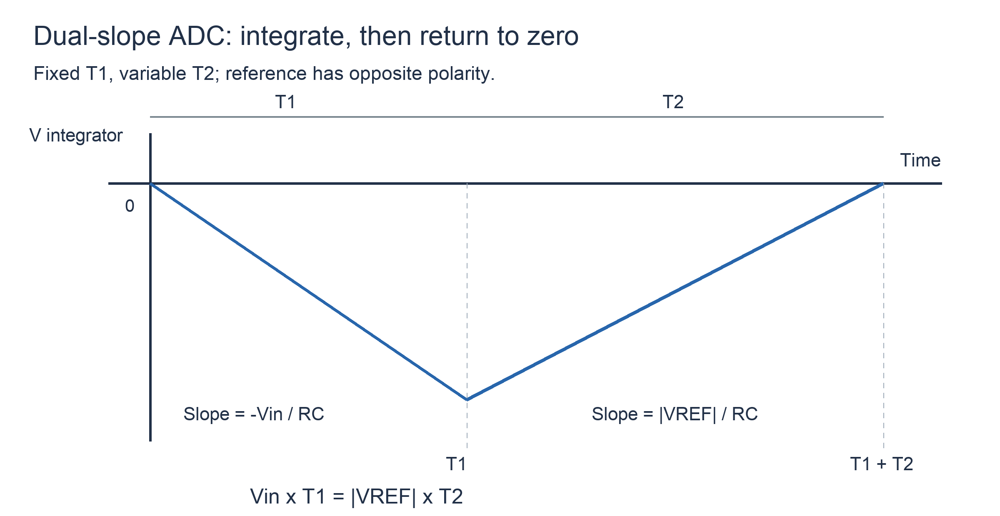

# A／D转换器

## 知识点介绍

ADC 将输入模拟量映射为有限个数字码。采样规定取值时刻，保持维持转换期间的输入，量化划分幅值区间，编码给出区间编号；代码无法保留区间内的全部细节。

## 原理讲解与图示

### 量化区间必须与判决规则一致

对跨度 $V_S$、n 位单极性 ADC，理想步长 $q=V_S/2^n$。若题目采用向下取整：

$$D=\left\lfloor\frac{V_{in}}q\right\rfloor,\qquad Dq\le V_{in}<(D+1)q.$$

输入限于 $0\le V_{in}<V_S$，最大码为 $2^n-1$。将 $Dq$ 当作重建值时，误差 $e=Dq-V_{in}$ 属于 $(-q,0]$。若采用就近舍入，内部码区间以代码重建值为中心，量化误差界才通常写成 $\pm q/2$；端点还受饱和范围影响。

### 并行比较型（Flash）

参考电阻串产生多个阈值，比较器同时比较输入与各阈值，输出温度计码，再经编码得到二进制码。传统 n 位全并行结构需要 $2^n-1$ 个比较器。

比较器数量随位数指数增长，换来较短的判决路径。阈值相等时输出取哪一侧，必须由题面约定；有偏移的比较器会使实际码区间不等宽。

### 逐次逼近型（SAR）

从最高位开始，先把当前位试置 1，内部 DAC 生成试探电压。若输入足以支持该试探值，就保留该位；否则清零，再试下一位。每次判决把剩余范围约缩小一半，n 位结果通常需要 n 次比较，但总转换周期还可能包含采样、初始化和结果传送。

SAR 内部 DAC 偏差和比较器偏移会改变试探阈值；分析实际转换时应逐次写出**真实阈值**与比较结果，而不是先按理想量化公式得码再修正。

### 双积分型

先让 $V_{in}$ 积分固定时间 $T_1$，再用相反极性的参考电压反向积分到零。取输入为正、参考幅值为 $|V_{REF}|$：

$$\Delta V_1=-\frac{V_{in}T_1}{RC},\qquad \Delta V_2=\frac{|V_{REF}|T_2}{RC}.$$

回零意味着两段变化量抵消，因此：

$$V_{in}=|V_{REF}|\frac{T_2}{T_1}=|V_{REF}|\frac{N_2}{N_1}.$$

最后一步要求两段使用相同计数时钟。理想公式中 RC 消去，但参考源、时钟关系、积分器误差和比较器判决仍影响精度。

若固定积分窗口覆盖干扰的整数个周期，零均值周期干扰的积分可抵消；频率偏离或窗口不匹配时，残余误差一般不再为零。

### 采样保持与系统握手

输入在逐位比较或积分期间变化，会破坏用于推导的固定输入条件。系统还需约定启动、忙、完成与数据有效的先后关系：完成指示与数据同时更新时，下游同沿寄存器通常只能采到旧值，应按接口时序安排读取沿。

## 配套例题

### 例题 20-01｜并行比较

设计理想 3 位 Flash ADC，输入范围 0—8 V，比较阈值为 1、2、…、7 V，各比较器在 $V_{in}$ 大于等于其阈值时输出 1，最后编码为向下取整并在 111 饱和的二进制数。求比较器数并写输入 3.4 V、6.2 V 对应的比较器输出向量和代码。向量按阈值由低到高排列。

### 例题 20-02｜非理想SAR判决与码区间

10 位 SAR ADC 内部理想 DAC 满足 $V_{DAC}=4.096D/1024$ V。采样输入在转换期间保持不变；比较器存在固定输入等效偏移 Vos=+3 mV，判决规则为 $V_{in}+V_{os}\ge V_{DAC}$ 时保留试探位，否则清零。从最高位逐位判决，相等时保留。

1. 对 Vin=1.703 V 列全部试探过程并求最终代码。
2. 对一般输出码 k（取内部非端点码），求其对应的真实输入电压区间及边界包含关系。
3. 用理想重建值 $4.096D/1024$ 定义重建电压，求非饱和区间的重建误差范围，区分量化与固定偏移。
4. 每位判决需要 0.4 μs，采样及控制开销合计 1.2 μs；无流水。求最大转换率，并判断用于 100 kS/s 采样是否满足时间要求。

### 例题 20-03｜双积分转换与周期干扰

理想双积分 ADC 固定积分时间 T1=20 ms，反积分参考幅值为 2.5 V，计数时钟 200 kHz。积分阶段输入为 $v(t)=1.2+0.05\sin(2\pi ft+\phi)$ V，第一阶段从 t=0 开始，φ 未知；第二阶段仅施加参考电压。忽略计数截断、开关误差和其他开销。

1. 对 f=50 Hz，求积分所得平均输入、反积分时间及计数值是否依赖 φ。
2. 改为 f=60 Hz，推导由干扰造成的平均输入误差随 φ 的表达式，并求其最大绝对值。
3. 若要求固定积分窗口同时包含整数个 50 Hz 与 60 Hz 周期，求最短正 T1，并计算输入无干扰且为 1.2 V 时的总积分时间。
4. 比较延长积分窗口对抗干扰、吞吐率和计数器位宽的影响。计数器应覆盖输入 0—2.5 V，求两种 T1 下反积分计数所需最少位数。

---

资料对应：《考点精讲》194—201 页；ADI ADC 架构与教学章节。PDF 页码从封面计；来源见 [[资料来源与勘误]]。
